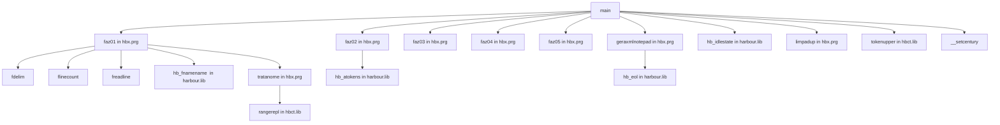

# 📘 Documentacao Tecnica do Projeto
> Gerado em: 25/10/2026 13:55:23

## 🏗️ Estrutura de Modulos (PRGs)

### 📄 Arquivo: `hbx`
- Function main()
- Function faz02()
- Function faz01()
- Function limpadup()
- Function faz04()
- Function TRATANOME()
- Function faz05()
- Function faz03()
- Function geraxmlnotepad()

## 📊 Dicionario de Dados e Acessos

## 🕸️ Diagrama de Relacionamento (Mermaid)

